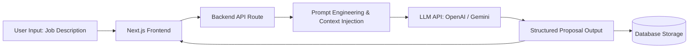

# 🚀 ProposalCraft AI

**ProposalCraft AI** is an intelligent, full-stack SaaS platform designed to help freelancers and digital agencies generate highly personalized, conversion-focused project proposals in seconds using Generative AI.

---

### ✨ Key Features

- **AI-Powered Proposal Generation:** Analyzes client job descriptions and automatically drafts tailored, persuasive proposals using OpenAI / Gemini APIs.
- **Customizable Tone & Templates:** Choose from multiple professional tones (Consultative, Direct, Technical) and save reusable portfolio snippets.
- **User Authentication & Dashboard:** Secure user login, proposal history tracking, and usage credit management.
- **One-Click Export:** Copy formatted proposals directly or export them as clean PDF/Markdown files.

---

### 🛠️ Tech Stack

- **Frontend:** Next.js (App Router), React, Tailwind CSS, Lucide Icons
- **Backend:** Node.js, Express / Next.js API Routes
- **Database & Auth:** PostgreSQL (Supabase) / MongoDB, NextAuth.js
- **AI Integration:** OpenAI API / Google Gemini API, LangChain

---

### 🏗️ System Architecture



---

### 🚀 Getting Started

#### Prerequisites
- Node.js (v18 or higher)
- npm or yarn
- An API key from OpenAI or Google AI Studio

#### Installation

1. **Clone the repository:**
   ```bash
   git clone [https://github.com/YOUR_GITHUB_USERNAME/proposalcraft-ai.git](https://github.com/YOUR_GITHUB_USERNAME/proposalcraft-ai.git)
   cd proposalcraft-ai
   ```

2. **Install dependencies:**
   ```bash
   npm install
   ```

3. **Configure Environment Variables:**
   Create a `.env.local` file in the root directory and add the following keys (refer to `.env.example`):
   ```env
   DATABASE_URL="your_database_connection_string"
   NEXTAUTH_SECRET="your_nextauth_secret"
   OPENAI_API_KEY="your_openai_api_key"
   GEMINI_API_KEY="your_gemini_api_key"
   ```

4. **Run the development server:**
   ```bash
   npm run dev
   ```
   Open [http://localhost:3000](http://localhost:3000) in your browser to see the application.

---

### 📄 License
This project is licensed under the MIT License - see the [LICENSE](LICENSE) file for details.
